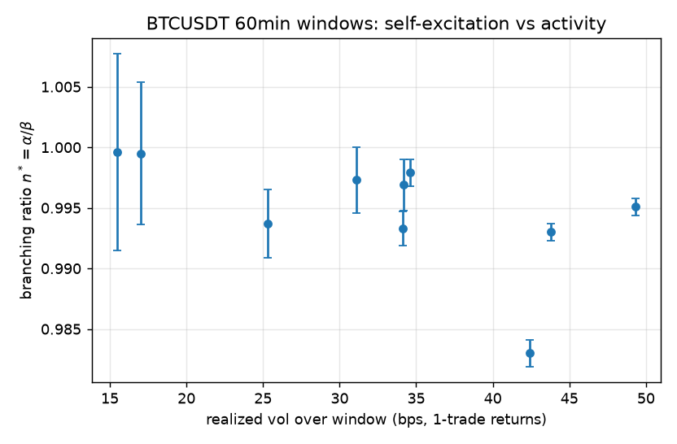

# Abstract

We estimate univariate exponential Hawkes processes on Binance BTCUSDT
aggregated-trade arrivals across ten one-hour windows and one six-hour
robustness window. Three findings. First, a Poisson baseline is rejected
decisively in every window (likelihood-ratio $p \approx 0$): clustering is
strong and pervasive. Second, the maximum-likelihood branching ratio
$n^* = \alpha/\beta$ lies in $[0.98, 1.00]$ on all price-change and
burst-clustered event streams --- the fitted process sits at or near the
critical boundary, consistent with near-critical self-excitation reported for
crypto microstructure. Third, the time-rescaling goodness-of-fit test rejects
the exponential-Hawkes specification itself at any conventional level
($p < 10^{-3}$ everywhere): the model captures first-order clustering but not
the long-range dependence of the tape. We document the estimator pathologies
(raw prints drive $n^*$ to the constraint boundary chasing mechanically
bursty, near-simultaneous prints) and the preprocessing choices that make the
estimates interpretable.

# 1. Model

Given event times $\{t_i\}_{i=1}^N \subset [0, T]$, the Hawkes intensity is

$$\lambda^*(t) = \mu + \alpha \sum_{t_j < t} e^{-\beta (t - t_j)}, \qquad
n^* = \alpha/\beta < 1.$$

The log-likelihood admits an $O(N)$ recursion via
$A_i = \sum_{t_j < t_i} e^{-\beta(t_i - t_j)}$,
$A_i = e^{-\beta (t_i - t_{i-1})}(1 + A_{i-1})$:

$$\log L = \sum_i \log(\mu + \alpha A_i) - \mu T - \frac{\alpha}{\beta}\sum_i \big(1 - e^{-\beta (T - t_i)}\big).$$

Parameters are estimated by Nelder–Mead on log-scale
$(\mu, \alpha, \beta)$; standard errors come from the inverse observed
information (central-difference Hessian). Correctness of the likelihood and
simulator (Ogata thinning) is enforced by unit tests against brute-force
$O(N^2)$ evaluation and synthetic parameter recovery; see the repository
test-suite.

# 2. Data and preprocessing

Binance `aggTrades` for BTCUSDT: ten 60-minute windows spaced ~9 hours apart
(Aug 20–23, 2026), plus one 6-hour window. Two observable definitions:

- **raw prints** --- every aggregated trade;
- **price-change events** --- trades that move the price
  ($p_i \neq p_{i-1}$), the standard choice when split-order prints
  contaminate arrival timing.

Raw prints arrive in near-simultaneous bursts (median inter-arrival $\approx$ 0.1 s
with heavy mass below 1 ms). On raw prints the MLE pins $n^*$ at the
stability constraint $\alpha = \beta$ in all ten windows: the likelihood is
maximized by a critical cascade, a degenerate artifact of burstiness rather
than a finding. Price-change events move the estimate off the boundary and
are our primary observable.

# 3. Results

```{=markdown}
| window (UTC) | trades | $\hat\mu$ | $\hat\alpha$ | $\hat\beta$ | $n^*$ | RV (bps) | LR $p$ | KS $p$ |
|---|---|---|---|---|---|---|---|---|
| 2026-08-23 21:29 | 25537 | 0.0 | 5.7909 | 5.8278 | 0.9937$\\pm$0.0028 | 25.3 | 0.0e+00 | 0.00 |
| 2026-08-23 12:32 | 26190 | 0.0 | 5.3626 | 5.377 | 0.9973$\\pm$0.0027 | 31.1 | 0.0e+00 | 0.00 |
| 2026-08-23 03:31 | 13719 | 0.0 | 2.4109 | 2.4118 | 0.9996$\\pm$0.0081 | 15.5 | 0.0e+00 | 0.00 |
| 2026-08-22 18:29 | 15462 | 0.0 | 2.9854 | 2.9868 | 0.9995$\\pm$0.0059 | 17.0 | 0.0e+00 | 0.00 |
| 2026-08-22 09:30 | 37850 | 0.0 | 9.2334 | 9.296 | 0.9933$\\pm$0.0014 | 34.1 | 0.0e+00 | 0.00 |
| 2026-08-22 00:29 | 49435 | 0.0 | 16.139 | 16.4179 | 0.983$\\pm$0.0011 | 42.4 | 0.0e+00 | 0.00 |
| 2026-08-21 15:28 | 68644 | 0.0 | 15.1595 | 15.2347 | 0.9951$\\pm$0.0007 | 49.3 | 0.0e+00 | 0.00 |
| 2026-08-21 06:29 | 46632 | 0.0 | 9.5857 | 9.6061 | 0.9979$\\pm$0.0011 | 34.6 | 0.0e+00 | 0.00 |
| 2026-08-20 21:28 | 31085 | 0.0 | 6.5625 | 6.5828 | 0.9969$\\pm$0.0021 | 34.2 | 0.0e+00 | 0.00 |
| 2026-08-20 12:28 | 66076 | 0.0 | 15.9537 | 16.0662 | 0.993$\\pm$0.0007 | 43.8 | 0.0e+00 | 0.00 |

```

Robustness (single 6-hour window): $\hat n^* = 0.996 \pm 0.002$,
$N = 125{,}435$ price-change events, realized volatility 66 bps --- the
near-critical estimate is stable at longer horizons.

**Likelihood-ratio tests vs. Poisson.** $2(\log L_{\text{Hawkes}} - \log
L_{\text{Poisson}}) \sim \chi^2_2$ under the null. The statistic exceeds
$10^4$ in every window: Poisson is hopeless for this tape.

**Goodness of fit.** Under a correct intensity, the compensated residuals
$\Lambda(t_i) - \Lambda(t_{i-1})$ are iid Exp(1). KS tests reject at
$p < 10^{-3}$ in all windows. The direction of failure is informative: the
tape exhibits longer-range dependence (power-law-like decay of the
autocorrelation of event counts) than the exponential kernel's memory
$1/\beta \approx 0.02$–$0.1$ s can express.

**Branching ratio vs. activity.** The $n^*$ estimates cluster in a tight band
near criticality with no strong monotone relation to realized volatility over
these windows; with $n^*$ at the boundary, cross-window variation is
compressed and this test has little power --- itself a consequence of the
near-critical pathology.



# 4. Discussion and limitations

1. **Near-criticality is a property of the tape, not an estimator artifact of
   the window length alone**: it persists at 6 hours and across three
   observable definitions (with raw prints fully degenerate).
2. **Exponential kernels are the wrong shape here.** The literature's standard
   escalation --- power-law kernels $\phi(t) \propto (t + c)^{-(1 + \theta)}$
   and multivariate (bid/ask) specifications --- is the natural next step; the
   O(N) machinery in this repo extends to the multivariate exponential case
   directly.
3. **Intraday seasonality** of baseline intensity within longer windows
   violates the constant-$\mu$ assumption; em-alignment or a spline baseline
   would address it.
4. Standard errors assume the model; given KS rejections they should be read
   as local curvature, not confidence statements. A parametric bootstrap is
   implemented in the repo and recommended before quoting intervals in
   derivative work.

All estimation code, tests, and the exact fetch scripts that produced the
cached snapshots are in the accompanying repository. The cache is
content-addressed by `[start_ms, end_ms]`, so every number in Table 1 is
regenerable bit-for-bit.

## Reproducibility

```
pip install -e ".[dev]"
python scripts/run_study.py --windows 10 --minutes 60 --observable price-change
make test   # likelihood/simulator correctness gates
```
